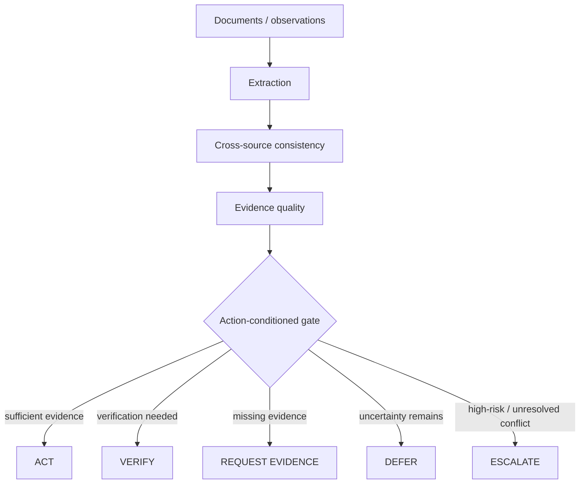

# Evidence-Gated Autonomy — Architecture

The core research object is an **action authorization gate**, not an autonomous customs system.

Evidence quality considers provenance, freshness, source independence, conflicts and verification state.

## Boundary

This diagram describes the implemented research abstraction. It does not imply production customs automation, physical scanner integration, regulatory approval, human-subject validation or deployment.
